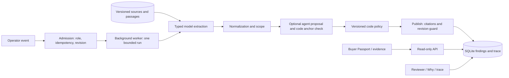

# Product Truth Passport

Cosmetics listings combine facts from several sources, sometimes for different variants or markets. Product Truth Passport compares volume, skin type, key ingredients, notification number and responsible company against stored source snapshots. Each field shows its own finding and a locator-checked quote. The model extracts claims; versioned code decides what can be published. The result describes the sources checked and does not establish product origin or suitability.

## Repository status — 1 November 2026

The team reports that the contest entry has been submitted. This checkout includes `sync-5`; subsequent work is repository maintenance, not a replacement submission. See the [P1–P4 closeout](docs/results/repository-closeout-20261101.md) for current checks, role deliverables and remaining work. The checked-in test phase is **5**. The `freeze` tag records an accepted scope checkpoint, not complete provider replay coverage.

Browse the [replay screenshots and their evidence boundaries](docs/results/screens/README.md). The [current issue list](docs/tracking/ISSUES.md) distinguishes implemented features from retained limitations; historical contest plans are not a current completion checklist.

## Running demo

P4 recorded a silent **90.03-second LIVE** demo: REAL product → initial comparison → OpenAI Web Search → source audit/new snapshots → updated Passport → evidence → Why/trace. [Local demo.mp4](scripts/demo/out/live-p4-20261031/demo.mp4) is an ignored local artifact, not a public URL. See the [as-made storyboard](scripts/demo/storyboard.md), [video description](scripts/demo/video-description.md) and [recording evidence](docs/results/live-demo.md). Web search stored two new REAL snapshots, adding one independent source family. Two other pages returned403, so the video retains the actual PARTIAL state and blocked-page audit. Code performs the comparison.

## What is different

- Field-level evidence keeps unsupported details visible instead of combining them into a product score.
- Self-conflict inside a source is distinguished from disagreement attributed to a listing.
- Source events stale only dependent fields; revision checks prevent an old run replacing newer results.
- Scope agents propose placements; code checks passage anchors before policy can use them. Learned vocabulary carries provenance and can confirm, never accuse.
- Buyer reads use stored results and make no model calls. Reviewer decisions bind to one result and case revision.

**Deep Domain AI:** cosmetics field normalization, source independence, variant/market scope and citation checks. Evidence: [S4 gate](docs/results/sync-4-gate.md), [blind diagnostic](docs/results/blind-summary.md).

**Autonomous & Adaptive AI:** bounded agent proposals, code anchor validation, event-driven rechecks and audited web discovery. Offline integration is documented in [S4 handoff](docs/tracking/HANDOFF.md); these are not claims that every feature appears in the LIVE video. Web/receipt scenes are optional and are included only after runtime validation.

## Architecture as integrated



Implementation details and historical plans: [architecture](docs/03-architecture.md), [contracts](docs/05-contracts.md), [AI integration](docs/07-ai-integration.md).

## Run locally on Windows

Use Python 3.11/3.12 and Node 24. Check `python --version` and `node --version` first. The Python launcher is optional: if `py -3.12` cannot find an installation, use the full path to an installed Python 3.11/3.12 executable. From the repository root, for a new checkout:

```powershell
python -m venv backend/.venv
backend/.venv/Scripts/python.exe -m pip install -r backend/requirements.txt
backend/.venv/Scripts/python.exe -m pip check
if (-not (Test-Path -LiteralPath backend/.env)) {
    Copy-Item -LiteralPath backend/.env.example -Destination backend/.env
}
npm.cmd ci --prefix frontend
```

For an existing checkout, reuse its venv and preserve `backend/.env`. The example defaults to `LLM_MODE=fallback`: rule-only extraction, no provider key required. The API key belongs only in that ignored file. The command below selects a separate local database; it does not use P4's recording database. Do not change modes on a populated demo database when trying to reproduce a different mode's evidence.

Run the following commands in separate terminals for the explicit offline/API setup below. The Local **backend** Action uses your configured backend environment; **frontend** explicitly uses `VITE_USE_MOCK=0`. A plain development command without that override defaults to mock data.

```powershell
# backend terminal, from repository root
cd backend
$env:LLM_MODE='fallback'
$env:WEB_SEARCH='off'
$env:DB_PATH='passport-local.db'
.venv/Scripts/python.exe -m uvicorn app.main:app --host 127.0.0.1 --port 8000
```

```powershell
# frontend terminal, from repository root
$env:VITE_USE_MOCK='0'
cd frontend
npm.cmd run dev
```

Open `http://localhost:5173`. Select an existing product and the Operator role, run its bootstrap event, then inspect Buyer Passport and evidence. The registry connector is a labelled mock. Reset clears the configured database; use only an isolated demo DB.

If port8000 is already in use, use the existing backend Action or stop that exact server before restarting; do not start a second backend on the same port. Check `http://127.0.0.1:8000/api/health` and `/openapi.json`; the bare API root may return404. Vite serves the UI on5173. For single-origin hosting, use the [Render wrapper](scripts/dev/render/server.py), which serves the built frontend and API together.

`LLM_MODE=live` calls the provider and requires a key. `record` adds immutable recordings. `replay` requires matching model, prompt, schema and input hashes and runs without a key; a missing recording is an error. To use shipped recordings, set `LLM_MODE=replay`, `REPLAY_FREEZE=1`, `MODEL_EXTRACT=gpt-6.1-sol`, `MODEL_AGENT=gpt-6.1-sol` and `MODEL_CHEAP=gpt-6.1-sol` in that backend terminal, choose a separate `DB_PATH`, then start the server. These IDs match existing recordings; they are not a live-model recommendation. `sync-5` reports a replay failure at event06 and does not establish whole-story replay coverage. `fallback` is labelled rule-only extraction and is used for offline tests, not the LIVE video.

## Checks and measured results

```powershell
cd backend
$env:LLM_MODE='fallback'
$env:WORKER_INLINE='1'
$env:OCR_ENABLED='0'
$env:WEB_SEARCH='off' # process-local offline default; web tests enable their own seam
$env:AGENTS_TRACING='0'
$env:OPENAI_AGENTS_DISABLE_TRACING='1'
$env:MODEL_AGENT='gpt-6.1-sol' # existing price-book key for offline budget checks
$env:CONTEST_PHASE=(Get-Content -Raw tests/PHASE).Trim()
.venv/Scripts/python.exe -m pytest -q tests ../frontend/tests/test_backend_contract.py ../scripts/dev/render/tests
# In a separate frontend terminal:
# npm.cmd test
# $env:VITE_USE_MOCK='0'
# npm.cmd run build
```

`MODEL_AGENT` is required by the offline cost-reservation check even though the suite uses provider seams. An empty value fails with `MODEL_PRICE_NOT_REVIEWED` before that test reaches the dollar-cap assertion. CI sets the same model explicitly and uses the checked-in phase. Current results and exact reproduction commands are in the [dated closeout report](docs/results/repository-closeout-20261101.md); the table below preserves contest-day measurements.

Local Action **tests** runs backend pytest at the checked-in phase with the same offline settings. **sync_check** runs the implemented story1–4 verifier with `--mode fallback` in a temporary database; it prints that narrower scope and keeps the current test phase unchanged. The script has no phase5 story command. This Action is not a full replay check or a replacement for the phase5 suite.

| Evidence, measured 31 October 2026 | Result and boundary |
|---|---|
| [S4 incremental backend gate](docs/results/sync-4-gate.md) | Passing receipts cover 1,626 currently collected nodes; not one new full-suite run. Offline/fallback; no unresolved failures or skips. |
| [S4 frontend](docs/results/sync-4-gate.md) | 93 Node tests and API production build passed. |
| [S4 fixture/path checks](docs/results/sync-4-gate.md) | 101 fixture files validated; 36/36 incremental in-process path checks. |
| [Blind diagnostic](docs/results/blind-summary.md) | DRAFT labels; preliminary metrics only. Original first run and separate rerun are preserved. |
| [LIVE video evidence](docs/results/live-demo.md) | Runtime trace, spend estimate, read-only check and media QA reported separately from offline tests. |

The evaluation sets are small and gold remains DRAFT until human review. REAL snapshots and SYNTHETIC fixtures are labelled separately. The app does not infer missing evidence. OCR, marketplace UI and complete provider replay remain outside the demonstrated video scope. The Sites workspace is preserved; this local recording does not update or publish it.

## How Codex was used and prepared materials

Codex assisted four lanes with typed contracts, implementation, offline tests, trace debugging, integration and recording. Inspect [CODEX_LOG](docs/tracking/CODEX_LOG.md), [measured usage](docs/results/codex-usage.md) and [living ExecPlans](.agent/plans/) for evidence rather than an inferred productivity percentage.

The preparation pack and `_outside-repo/skills/mvp-demo` were present before the event (29–30 October). The kit is personal recording/assembly tooling, not application implementation built during the contest. Source captures and application work are documented separately. The [submission template](docs/team-plan/SUBMISSION.md) is historical planning material, not a copy of the team's submitted form. The team confirmed submission on1November; the exact submitted document, URL and receipt are not archived in this checkout.

P4's recorders are [record_live_demo.py](scripts/demo/record_live_demo.py) and [record_web_demo.py](scripts/demo/record_web_demo.py). They use the existing personal video venv, store original takes, validate LIVE trace provenance and assemble with the prepared demo kit. No voice or TTS is used. No upload, commit, push or freeze is implied by producing the local video.
