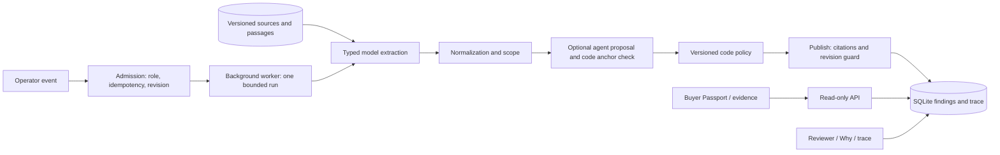

# Product Truth Passport

Cosmetics listings combine facts from several sources, sometimes for different variants or markets. Product Truth Passport compares volume, skin type, key ingredients, notification number and responsible company against stored source snapshots. Each field shows its own finding and a locator-checked quote. The model extracts claims; versioned code decides what can be published. The result describes the sources checked and does not establish product origin or suitability.

## Running demo

P4 recorded a silent **90.03-second LIVE** demo: REAL product → initial comparison → OpenAI Web Search → source audit/new snapshots → updated Passport → evidence → Why/trace. [Local demo.mp4](scripts/demo/out/live-p4-20261031/demo.mp4) is an ignored local artifact, not a public URL. See the [as-made storyboard](scripts/demo/storyboard.md), [video description](scripts/demo/video-description.md) and [recording evidence](docs/results/live-demo.md). Web search stored two new REAL snapshots, adding one independent source family. Two other pages returned403, so the video retains the actual PARTIAL state and blocked-page audit. Code performs the comparison.

## What is different

- Field-level evidence keeps unsupported details visible instead of combining them into a product score.
- Self-conflict inside a source is distinguished from disagreement attributed to a listing.
- Source events stale only dependent fields; revision checks prevent an old run replacing newer results.
- Scope agents propose placements; code checks passage anchors before policy can use them. Learned vocabulary carries provenance and can confirm, never accuse.
- Buyer reads use stored results and make no model calls. Reviewer decisions bind to one result and case revision.

**Deep Domain AI:** cosmetics field normalization, source independence, variant/market scope and citation checks. Evidence: [S4 gate](docs/results/sync-4-gate.md), [blind diagnostic](docs/results/blind-summary.md).

**Autonomous & Adaptive AI:** bounded agent proposals, code anchor validation, event-driven rechecks and audited web discovery. Offline integration is documented in [S4 handoff](docs/tracking/HANDOFF.md); these are not claims that every feature appears in the LIVE video. Web/receipt scenes are optional and are included only after runtime validation.

## Architecture as integrated



Implementation details and historical plans: [architecture](docs/03-architecture.md), [contracts](docs/05-contracts.md), [AI integration](docs/07-ai-integration.md).

## Run locally on Windows

Use Python 3.11/3.12 and Node 24. From the repository root:

```powershell
py -3.12 -m venv backend/.venv
backend/.venv/Scripts/python.exe -m pip install -r backend/requirements.txt
Copy-Item backend/.env.example backend/.env
cd frontend
npm ci
```

Do not overwrite an existing `backend/.env`. Set the model IDs and mode there; the API key belongs only in that ignored file. Choose a separate `DB_PATH` for demonstrations. The current recording uses `scripts/demo/out/live-p4-20261031/passport.db`.

Start the Local **backend** and **frontend** Actions, or run their commands in separate terminals:

```powershell
# backend terminal, from repository root
cd backend
.venv/Scripts/python.exe -m uvicorn app.main:app --host 127.0.0.1 --port 8000
```

```powershell
# frontend terminal, from repository root
$env:VITE_USE_MOCK='0'
cd frontend
npm run dev
```

Open `http://localhost:5173`. Select an existing product and the Operator role, run its bootstrap event, then inspect Buyer Passport and evidence. The registry connector is a labelled mock. Reset clears the configured database; use only an isolated demo DB.

`LLM_MODE=live` calls the provider and requires a key. `record` adds immutable recordings. `replay` requires matching recordings and runs without a key; a missing recording is an error. Whole-story replay coverage is not claimed by the S4 offline gate. `fallback` is labelled rule-only extraction and is used for offline tests, not this LIVE video.

## Checks and measured results

```powershell
cd backend
$env:LLM_MODE='fallback'
$env:WORKER_INLINE='1'
$env:WEB_SEARCH='off' # process-local offline default; web tests enable their own seam
$env:CONTEST_PHASE='4'
.venv/Scripts/python.exe -m pytest -q
# in frontend: npm test; npm run build
```

| Evidence, measured 31 October 2026 | Result and boundary |
|---|---|
| [S4 incremental backend gate](docs/results/sync-4-gate.md) | Passing receipts cover 1,626 currently collected nodes; not one new full-suite run. Offline/fallback; no unresolved failures or skips. |
| [S4 frontend](docs/results/sync-4-gate.md) | 93 Node tests and API production build passed. |
| [S4 fixture/path checks](docs/results/sync-4-gate.md) | 101 fixture files validated; 36/36 incremental in-process path checks. |
| [Blind diagnostic](docs/results/blind-summary.md) | DRAFT labels; preliminary metrics only. Original first run and separate rerun are preserved. |
| [LIVE video evidence](docs/results/live-demo.md) | Runtime trace, spend estimate, read-only check and media QA reported separately from offline tests. |

The evaluation sets are small and gold remains DRAFT until human review. REAL snapshots and SYNTHETIC fixtures are labelled separately. The app does not infer missing evidence. OCR, marketplace UI and complete provider replay remain outside the demonstrated video scope. The Sites workspace is preserved; this local recording does not update or publish it.

## How Codex was used and prepared materials

Codex assisted four lanes with typed contracts, implementation, offline tests, trace debugging, integration and recording. Inspect [CODEX_LOG](docs/tracking/CODEX_LOG.md), [measured usage](docs/results/codex-usage.md) and [living ExecPlans](.agent/plans/) for evidence rather than an inferred productivity percentage.

The preparation pack and `_outside-repo/skills/mvp-demo` were present before the event (29–30 October). The kit is personal recording/assembly tooling, not application implementation built during the contest. Source captures and application work are documented separately. [Declaration/submission checklist](docs/team-plan/SUBMISSION.md) remains a submission template until completed by the team.

P4's recorders are [record_live_demo.py](scripts/demo/record_live_demo.py) and [record_web_demo.py](scripts/demo/record_web_demo.py). They use the existing personal video venv, store original takes, validate LIVE trace provenance and assemble with the prepared demo kit. No voice or TTS is used. No upload, commit, push or freeze is implied by producing the local video.
