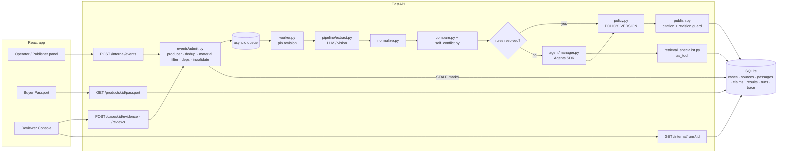

# 03 — Architecture (demo build)

One FastAPI process, one SQLite file, one in-process asyncio worker, one React app. Logical blocks below are modules, not services.



## Run lifecycle

```
event received
  └─ admit: producer allowed? payload valid? idempotency key new? material change?
       ├─ no  → record + NOOP (no job, no model call)
       └─ yes → find dependent (product, field) results → mark STALE → enqueue job(case_id, revision)
worker
  └─ pin revision → load snapshots → extract claims (LLM, cached by source_version_id)
     → normalize → scope match → compare exact → self-conflict check
     → unresolved? → Manager (≤3 turns) → retrieval specialist (≤2 hops) → evidence bundle + gaps
     → policy → publish gate (citation valid, revision still latest, source not revoked)
     → FieldResult rows (versioned) + trace
     → needs review? → ReviewTask; insufficient? → EvidenceRequest
```

Run status: `QUEUED → RUNNING → COMPLETED | PARTIAL | WAITING_EVIDENCE | WAITING_REVIEW | FAILED | CANCELLED`.

## When AI runs

| Trigger | AI call? |
|---|---|
| Bootstrap / new source version | Yes — extraction (once per source version; cached) |
| Listing price/stock change only | **No** (filtered as non-material) |
| Duplicate event | **No** |
| Revoke notification | **No** to mark STALE; re-assessment uses cached claims, Manager only if unresolved |
| Rules leave a field unresolved (ambiguous scope, conflict needs more evidence) | Manager + specialist |
| Buyer opens / refreshes Passport | **Never** |
| Reviewer approves | No |

## Key invariants (tested)

- Extraction cache key = `source_version_id` + `prompt_version` + `model`. Same input never re-extracted.
- `FieldResult` is append-only with `result_version`; the read API returns the latest non-superseded one.
- Publish compares the run's pinned `case_revision` with the current one; older run → result discarded, trace notes `SUPERSEDED_RUN`.
- Revoked source passages are excluded from current conclusions but kept in history.

## Extended modules (design, beyond the diagram)

The diagram is the core design. These modules extend it; build each one if its feature is in scope.

| Block | Module | What it does |
|---|---|---|
| Scope pre-pass + agent | `pipeline/scope_prepass.py`, `agent/scope_resolution.py` | Code decides every passage of a multi-variant source that names a size; the agent places size-less passages with an anchor; code verifies the anchor (BR-05a) |
| Coverage re-ask | `pipeline/extract.py` | Rule extractor as a detector; ≤1 targeted re-ask per source version |
| Learned vocabulary | `pipeline/canon.py`, `pipeline/normalize.py`, `data/vocab_seed.json` | Seed + model-proposed, code-verified mappings with provenance; asymmetric trust |
| Gap controller | `pipeline/gaps.py`, `connectors/registry.py` | Multi-hop by code: label number → MOCK registry → holder compare → stop reason |
| Claim auditor | `pipeline/claims_audit.py`, `data/regulatory_limits.json` | Model finds marketing claims; code judges them against INCI |
| Hybrid retrieval | `retrieval/search.py`, `llm/embed.py` | BM25 + embeddings (computed at ingest) → RRF; ranking only |
| OCR boxes | `pipeline/ocr.py` | Code OCR locates the cited text on label images (never model coordinates) |
| Receipts + hash chain | `chain.py`, `api/orders.py` | Chained result history; buyer receipt with snapshot hash and chain head |
| Glass box | `api/observe.py`, `explain_json` | "Why?" decision path, observability counters |
| Marketplace consensus | `pipeline/marketplace.py` | Other sellers' listings outside the case; copy clusters; outliers → review |

Known risks (planning estimates): a budget that only covers the agent, a soft deadline, and an agent whose output code
cannot verify. The design answers them with one budget per run, a hard deadline with `PARTIAL`, and anchored placements.
