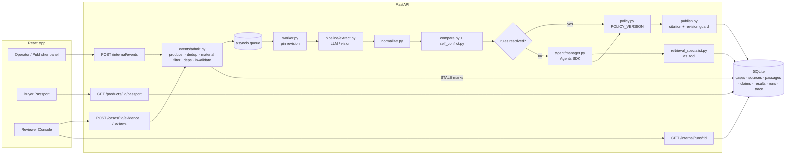

# 03 — Architecture (demo build)

One FastAPI process, one SQLite file, one in-process asyncio worker, one React app. Logical blocks below are modules, not services.



## Run lifecycle

```
event received
  └─ admit: producer allowed? payload valid? idempotency key new? material change?
       ├─ no  → record + NOOP (no job, no model call)
       └─ yes → find dependent (product, field) results → mark STALE → enqueue job(case_id, revision)
worker
  └─ pin revision → load snapshots → extract claims (LLM, cached by source_version_id)
     → normalize → scope match → compare exact → self-conflict check
     → unresolved? → Manager (≤3 turns) → retrieval specialist (≤2 hops) → evidence bundle + gaps
     → policy → publish gate (citation valid, revision still latest, source not revoked)
     → FieldResult rows (versioned) + trace
     → needs review? → ReviewTask; insufficient? → EvidenceRequest
```

Run status: `QUEUED → RUNNING → COMPLETED | PARTIAL | WAITING_EVIDENCE | WAITING_REVIEW | FAILED | CANCELLED`.

## When AI runs

| Trigger | AI call? |
|---|---|
| Bootstrap / new source version | Yes — extraction (once per source version; cached) |
| Listing price/stock change only | **No** (filtered as non-material) |
| Duplicate event | **No** |
| Revoke notification | **No** to mark STALE; re-assessment uses cached claims, Manager only if unresolved |
| Rules leave a field unresolved (ambiguous scope, conflict needs more evidence) | Manager + specialist |
| Buyer opens / refreshes Passport | **Never** |
| Reviewer approves | No |

## Key invariants (tested)

- Extraction cache key = `source_version_id` + `prompt_version` + `model`. Same input never re-extracted.
- `FieldResult` is append-only with `result_version`; the read API returns the latest non-superseded one.
- Publish compares the run's pinned `case_revision` with the current one; older run → result discarded, trace notes `SUPERSEDED_RUN`.
- Revoked source passages are excluded from current conclusions but kept in history.

## Extended modules (design, beyond the diagram)

The diagram is the core design. These modules extend it; build each one if its feature is in scope.

| Block | Module | What it does |
|---|---|---|
| Scope pre-pass + agent | `pipeline/scope_prepass.py`, `agent/scope_resolution.py` | Code decides every passage of a multi-variant source that names a size; the agent places size-less passages with an anchor; code verifies the anchor (BR-05a) |
| Coverage re-ask | `pipeline/extract.py` | Rule extractor as a detector; ≤1 targeted re-ask per source version |
| Learned vocabulary | `pipeline/canon.py`, `pipeline/normalize.py`, `data/vocab_seed.json` | Seed + model-proposed, code-verified mappings with provenance; asymmetric trust |
| Gap controller | `pipeline/gaps.py`, `connectors/registry.py` | Multi-hop by code: label number → MOCK registry → holder compare → stop reason |
| Claim auditor | `pipeline/claims_audit.py`, `data/regulatory_limits.json` | Model finds marketing claims; code judges them against INCI |
| Hybrid retrieval | `retrieval/search.py`, `llm/embed.py` | BM25 + embeddings (computed at ingest) → RRF; ranking only |
| OCR boxes | `pipeline/ocr.py` | Code OCR locates the cited text on label images (never model coordinates) |
| Receipts + hash chain | `chain.py`, `api/orders.py` | Chained result history; buyer receipt with snapshot hash and chain head |
| Glass box | `api/observe.py`, `explain_json` | "Why?" decision path, observability counters |
| Marketplace consensus | `pipeline/marketplace.py` | Other sellers' listings outside the case; copy clusters; outliers → review |

Known risks (planning estimates): a budget that only covers the agent, a soft deadline, and an agent whose output code
cannot verify. The design answers them with one budget per run, a hard deadline with `PARTIAL`, and anchored placements.

## As built (contest)

### S4 local wiring after contract-4

Orders freeze one BUYER projection, case revision and verified chain head in the
writer transaction, hash those exact snapshot bytes, and validate them on reads.
Receipt diffs use a consistent read transaction; neither reads nor order creation
start pipeline work. Marketplace scans have separate runs with no case linkage,
PUBLIC outside-case sources, the existing extraction seam, one Budget, pure
consensus and a transactional marketplace publication gate. They cannot become
the case's latest run or write passport results. Case-run DTOs remain unchanged;
scan usage is counted directly for metrics/observability.

Explicit web events and eligible once-per-case automatic discovery call the P2
discover interface before extraction. Errors are traced and preserve independently
checked evidence. Empty stub outcomes are marked partial, not successful discovery.
Web audit reads persisted evidence only. Provider/OCR implementation and full S4
integration remain pending; tests cover a fake provider seam and real fallback
marketplace extraction. No demo DB reset is part of this delivery.

### S3 P1 orchestration

After public policy pass 1, unresolved fields invoke P2's scope resolver; P1 reloads
version-bound stored placements, retains quantity exclusions, reruns policy and
records agent:effect only when the code-decided verdict changes. P2's no-op stub
does not establish agent completion. Registry gaps use at most two MOCK lookups
under the same run Budget. Verified records retained before a later stop are
included in the final policy pass and PARTIAL publication. Connector errors are
traced REGISTRY_ERROR, preserving existing decisions. Usage is saved at run end.

All new result rows, including reviewer publications, call chain.append in the
publication writer transaction. Unchanged confirmations preserve their link.
Upgrade boundary: existing pre-S3 result rows have no chain metadata and cannot
accept a new link. Use an explicitly authorized demo reset for a fresh chain, or
design a separate migration; neither reads nor publication silently backfill or
repair history. No application database was reset during implementation checks.

S2 integrated extraction may retain validated claims after an optional retry exhausts its
Budget. After accepting those observations, P1 consumes the shared Budget.stop_reason through
the normal PARTIAL path, stops further extraction/audit, and publishes only assessed fields.
This also applies when the retry belonged to the final source and no later model step runs.

S1 P1: admission writes the event, field-specific STALE flags, case revision and queued job in one
SQLite write transaction. Duplicate keys write nothing; non-material listing events write only their event.
One QUEUED job per case coalesces to the newest revision. `worker.execute_job` drains persisted jobs,
inline for tests or via FastAPI BackgroundTasks for the single-process demo; a per-case lock serializes runs.
This is not a crash-recovery or multi-process queue. No new app-lifespan integration is required.

Runs pin their revision, construct one Budget, filter scope from stored metadata, invoke P2 extraction,
apply public-field policy and the existing claims-audit hook, and publish through one transactional gate.
Budget exhaustion preserves already verified observations and records PARTIAL plus the actual stop reason.
Each publication rereads the current case revision under the writer lock. An outdated run cannot publish.
Unchanged decisions retain their result version and record confirmation time/run; missing findings create
deduplicated local evidence requests. Buyer GETs read stored rows; only an in-memory read counter changes.
Source ingestion for material change events and reviewer workflows remain Phase 2 integration work.
