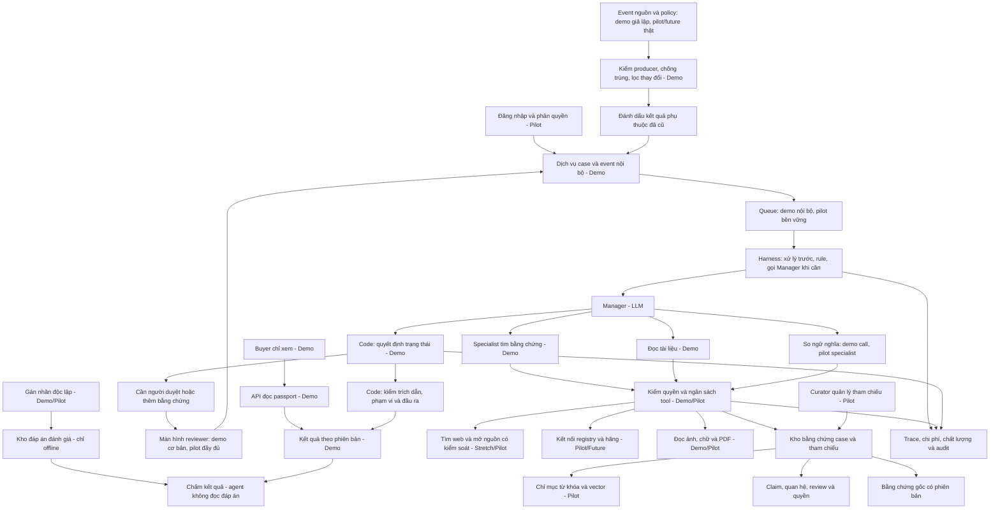
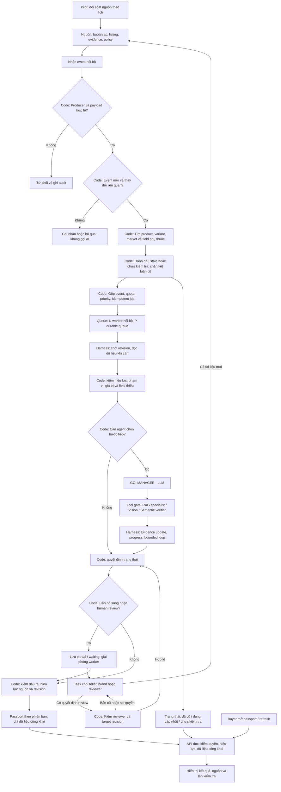
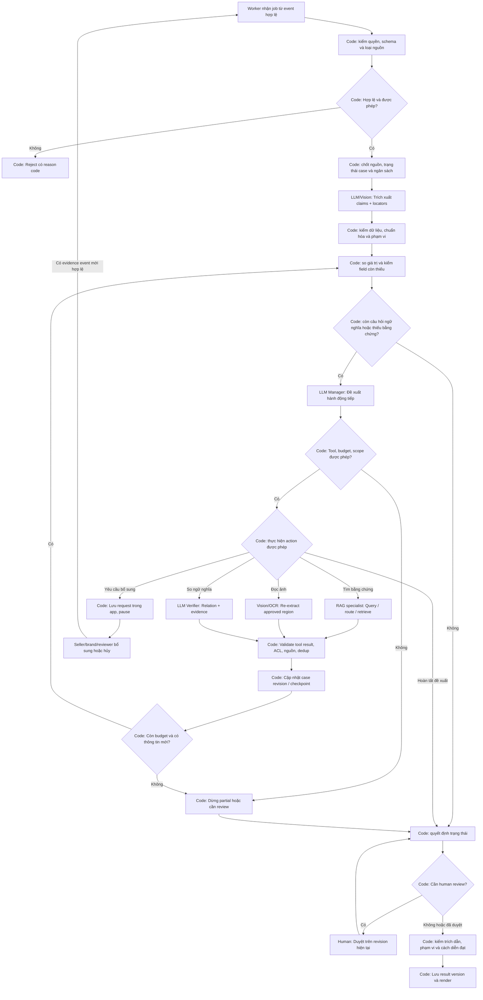
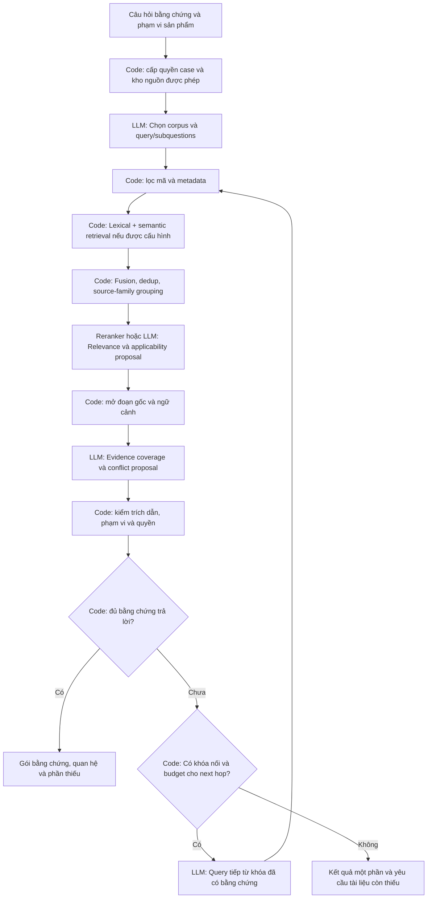

# Product Truth Passport - Hackathon Idea Form

## 1. Vấn đề và căn cứ

Người mua hoặc reviewer phải tự mở nhiều nguồn để trả lời ba câu hỏi: **có đúng cùng phiên bản sản phẩm không, các thông tin có khớp không, và cần thêm tài liệu gì để kết luận?** Product Truth Passport hỗ trợ công việc đó và lưu căn cứ cho từng kết quả.

| Đã có                                                           | Ý nghĩa và giới hạn                                                              |
| --------------------------------------------------------------- | -------------------------------------------------------------------------------- |
| Business Proposal và review.md                                  | Ý tưởng sản phẩm, yêu cầu baseline và demo gọn; chưa phải bằng chứng về hiệu quả |
| Audit 3 listing CeraVe                                          | Chưa xác nhận listing Shopee nào sai; có ca website hãng tự mâu thuẫn            |
| 0/3 hồ sơ công bố ghép đúng SKU; 0/3 chuỗi GTIN–lô; 0 phỏng vấn | Chưa đủ dữ liệu để xác thực hàng hoặc kết luận nhu cầu thị trường                |

Ca **Hydrating**: văn bản trang hãng đọc lại ngày 21/09/2026 vẫn có phần hướng tới da khô nhưng phần giới thiệu nhắc da thường/da dầu và tạo bọt S32. Đây là bất nhất của nguồn tham chiếu, không phải bằng chứng seller sai hay hàng giả.

**Giả định cần xác nhận:** nhân lực, thời gian và thể lệ cuộc thi; nhu cầu buyer/reviewer; quyền lấy dữ liệu. Chưa có API nội bộ Shopee hoặc hợp đồng dữ liệu registry. Kế hoạch 7 giờ bên dưới chỉ là ước lượng có điều kiện.

**Nhãn phạm vi dùng trong tài liệu:** D = demo bắt buộc; S = demo mở rộng nếu còn thời gian; P = pilot với dữ liệu/người dùng thật; F = hướng production tương lai. “Must” chỉ bắt buộc trong phạm vi ghi ở dòng đó.

## 2. Người dùng, thuật ngữ và kết quả

| Vai trò      | Làm gì?                                             |
| ------------ | --------------------------------------------------- |
| Buyer        | Xem passport và bằng chứng được phép công khai      |
| Seller/brand | Bổ sung tài liệu sản phẩm                           |
| Reviewer     | Kiểm tra ngoại lệ, duyệt hoặc sửa đề xuất có căn cứ |
| Curator      | Quản lý nguồn tham chiếu và nhãn đánh giá           |
| Operator     | Theo dõi lỗi, chi phí và xử lý sự kiện thất bại     |

**Thuật ngữ:** claim = một thông tin cần đối chiếu, ví dụ dung tích; case = hồ sơ kiểm tra; run = một lần xử lý; scope = sản phẩm/biến thể/thị trường/phiên bản mà nguồn áp dụng; locator = vị trí đoạn chữ hoặc vùng ảnh chứa bằng chứng; gap = phần bằng chứng còn thiếu.

Kết quả được ghi **theo từng thông tin**, không gom thành điểm “đáng tin 92%”.

| Thuộc tính     | Giá trị                                                              | Cách hiểu                                                          |
| -------------- | -------------------------------------------------------------------- | ------------------------------------------------------------------ |
| Đối chiếu      | CONSISTENT / CONFLICTING / INSUFFICIENT / UNCERTAIN / NOT_APPLICABLE | Nhất quán / mâu thuẫn / thiếu bằng chứng / chưa rõ / không áp dụng |
| Đúng phạm vi   | MATCH / MISMATCH / UNKNOWN                                           | Có đúng sản phẩm và phiên bản không?                               |
| Độ mới         | CURRENT / STALE / UNKNOWN                                            | Kết quả còn phù hợp với nguồn hiện tại không?                      |
| Đọc dữ liệu    | READABLE / PARTIAL / UNREADABLE                                      | Đọc được toàn bộ, một phần hay không đọc được?                     |
| Duyệt          | AUTO_DRAFT / NEEDS_REVIEW / REVIEWED / SUPERSEDED                    | Bản nháp, cần duyệt, đã duyệt hoặc đã thay thế                     |
| Cấp bằng chứng | LISTING / PRODUCT_VERSION / BATCH / UNIT                             | Chỉ áp dụng tới listing, phiên bản, lô hay đơn vị hàng?            |

CONSISTENT chỉ nghĩa các nguồn đã kiểm tra tương thích. Ảnh catalogue không chứng minh chai được giao; hồ sơ cấp sản phẩm không xác thực từng đơn vị hàng. Hệ thống không tự sửa/gỡ listing, hoàn tiền, tố cáo seller hoặc tạo tài liệu còn thiếu.

## 3. User stories — người dùng cần gì?

| ID    | Nhu cầu                                     | Điều kiện đạt                                                         | Liên quan                    |
| ----- | ------------------------------------------- | --------------------------------------------------------------------- | ---------------------------- |
| US-01 | Buyer xem passport tự cập nhật              | Có kết quả, lần kiểm tra và trạng thái cập nhật; không có nút chạy AI | FR-07/08/20, D               |
| US-02 | Buyer mở căn cứ của cảnh báo                | Mở đúng đoạn chữ/ảnh và phiên bản nguồn                               | FR-02/08, D                  |
| US-03 | Buyer hiểu phần chưa kiểm tra được          | Nêu rõ thiếu gì; không gọi thiếu dữ liệu là sản phẩm sai              | FR-08/09, D                  |
| US-04 | Reviewer phân biệt lỗi nguồn và lỗi listing | Hydrating được ghi là nguồn tự mâu thuẫn, không tự quy lỗi seller     | FR-05/07, D                  |
| US-05 | Reviewer tránh cảnh báo nhầm                | Khác tên vô hại không thành conflict; kiểm đúng market/version        | FR-04/05, D                  |
| US-06 | Seller/brand bổ sung tài liệu               | Tạo revision mới, giữ lịch sử và kiểm tra lại phần liên quan          | FR-09/10, D cơ bản/P đầy đủ  |
| US-07 | Reviewer duyệt hoặc sửa đề xuất             | Ghi người duyệt, căn cứ, lý do và revision; model không tự duyệt      | FR-11, D mô phỏng/P thật     |
| US-08 | Reviewer xem thông tin tại lúc mua          | Snapshot không bị thay bởi dữ liệu về sau                             | FR-12, S/F                   |
| US-09 | Curator rút hiệu lực nguồn                  | Kết quả phụ thuộc được đánh dấu stale                                 | FR-13, P                     |
| US-10 | Operator hiểu vì sao agent dừng             | Xem action, nguồn, lỗi và ngân sách trong trace                       | FR-14, D                     |
| US-11 | Người có quyền xem tài liệu riêng           | Chặn truy cập khác tenant/case trước tìm kiếm và mở nguồn             | FR-15, D kiểm scope/P đầy đủ |
| US-12 | Team biết agent có ích hơn baseline không   | So cùng dữ liệu, báo lỗi, coverage, latency và chi phí                | FR-16, D                     |

## 4. Functional requirements — hệ thống phải làm gì?

| ID    | Chức năng                         | Mức / phạm vi                      | Điều kiện nghiệm thu                                                                      |
| ----- | --------------------------------- | ---------------------------------- | ----------------------------------------------------------------------------------------- |
| FR-01 | Tạo/cập nhật case từ event        | Must/D                             | Có ID, scope, revision và nhãn REAL/SYNTHETIC; buyer không tạo run                        |
| FR-02 | Lưu bằng chứng gốc                | Must/D                             | Có snapshot, nguồn, thời điểm, hash và quyền xem; hash không chứng minh nội dung đúng     |
| FR-03 | Đọc claim từ text/ảnh             | Must/D                             | JSON đúng schema, có locator; không đọc được thì null; ít nhất một ca gọi model trực tiếp |
| FR-04 | Chuẩn hóa và ghép đúng phạm vi    | Must/D                             | Chuẩn hóa đơn vị; kiểm product/market/version; không ghép chỉ bằng độ giống embedding     |
| FR-05 | So sánh và phát hiện mâu thuẫn    | Must/D                             | Có kết quả từng field, giữ bằng chứng hai phía và kiểm nguồn tự mâu thuẫn                 |
| FR-06 | Tìm bằng chứng qua tool           | Must/D                             | Trả đoạn nguồn và gap từ corpus nhỏ được cấp quyền                                        |
| FR-07 | Quyết định trạng thái bằng code   | Must/D                             | Kiểm nguồn, phạm vi và dữ liệu thiếu; model không vượt policy                             |
| FR-08 | Buyer card và evidence viewer     | Must/D                             | Chỉ đọc; backend chặn buyer gửi event/upload/retry; refresh không tạo job                 |
| FR-09 | Yêu cầu tài liệu và kiểm tra lại  | Must/D                             | Yêu cầu gắn field/lý do; tài liệu từ seller/brand/reviewer tạo event mới                  |
| FR-10 | Đánh dấu kết quả cũ               | Must/D cơ bản, P đầy đủ            | Nguồn liên quan đổi hoặc bị thu hồi làm stale; đổi giá ngoài scope không gọi AI           |
| FR-11 | Duyệt kết quả                     | Should/D, Must/P                   | Kiểm role, lý do và revision khi ghi quyết định                                           |
| FR-12 | Snapshot lúc mua                  | Should/S, F tích hợp               | Order event demo có nhãn giả lập; tích hợp thật cần contract Shopee                       |
| FR-13 | Kho tham chiếu được duyệt         | Must/P                             | Có nguồn, scope, hiệu lực và curator; AI không tự nâng suy luận thành dữ kiện chuẩn       |
| FR-14 | Lịch sử chạy và trace             | Must/D                             | Có trace ID, action, nguồn, lỗi, latency và usage nếu API cung cấp                        |
| FR-15 | Phân quyền                        | Must/P                             | Kiểm role/tenant/case ở backend; model không chọn quyền                                   |
| FR-16 | Bộ đánh giá                       | Must/D                             | Tách đáp án, real/synthetic và tập phát triển/holdout                                     |
| FR-17 | Web và registry connector         | Should/S web, P/F registry         | Kiểm quyền và schema; web search chỉ tìm nguồn ứng viên                                   |
| FR-18 | Xử lý nền và chờ bổ sung          | Must/D đơn giản, P bền vững        | Dedup job; chờ thì giải phóng worker; run cũ không ghi đè revision mới                    |
| FR-19 | Thông báo ra ngoài                | F                                  | Có quyền, opt-in và chống gửi lặp; demo không gửi                                         |
| FR-20 | Bootstrap/update/revoke/reconcile | Must/D event giả lập, P/F tích hợp | Lọc thay đổi bằng code; agent chạy có điều kiện; xem mục 6 về phạm vi                     |

## 5. Non-functional requirements — chất lượng cần đạt

Các con số là mục tiêu đề xuất, chưa phải số đo hoặc SLA.

| ID     | Yêu cầu             | Demo và cách kiểm tra                                                   | Pilot/production                                   |
| ------ | ------------------- | ----------------------------------------------------------------------- | -------------------------------------------------- |
| NFR-01 | Có căn cứ           | Mọi kết luận có locator hoặc lý do thiếu; kiểm cả ý nghĩa trích dẫn     | Audit mẫu và human review                          |
| NFR-02 | Đúng giới hạn       | Không có câu chứng nhận thật/giả/an toàn trong bộ test                  | Policy và reviewer quản lý                         |
| NFR-03 | Tốc độ              | Mục tiêu case mới ≤60 giây, kết quả lưu sẵn ≤2 giây; ghi từng run       | Chốt p95/SLO sau khi có workload đại diện          |
| NFR-04 | Chi phí có giới hạn | Giới hạn thời gian, token, model/tool calls cho cả case                 | Quota tenant, cảnh báo và kiểm soát tải            |
| NFR-05 | Xử lý lỗi           | Timeout/nguồn lỗi trả partial/error, không sinh kết luận sai            | Retry, queue bền vững và phục hồi                  |
| NFR-06 | Không ghi lặp       | Phát lại event không nhân đôi evidence/request                          | Idempotency key và transactional outbox            |
| NFR-07 | Bảo mật             | Không lộ secret; kiểm scope và prompt injection                         | Identity, quyền tối thiểu và kiểm soát mạng        |
| NFR-08 | Riêng tư            | Không dùng dữ liệu cá nhân không cần thiết; kiểm log/export             | Mã hóa, retention và xóa dữ liệu                   |
| NFR-09 | Truy nguyên         | Lưu model/prompt/rule version, snapshot và tool results                 | Canary và rollback; không hứa LLM lặp lại từng bit |
| NFR-10 | Độ mới              | Phân biệt thời điểm thu thập, hiệu lực và quyết định                    | Cập nhật theo event và policy nguồn                |
| NFR-11 | Dễ sử dụng          | Nhãn chữ rõ, dùng được bàn phím; người đọc phân biệt thiếu và mâu thuẫn | UX test thực tế                                    |
| NFR-12 | Dễ bảo trì          | Schema/tool contract rõ; test khi đổi model/connector                   | Version hóa API và policy                          |
| NFR-13 | Quy mô              | Vài case, corpus nhỏ                                                    | Đo tải đọc/ghi riêng trước khi mở rộng             |

## 6. Kiến trúc và thời điểm hệ thống chạy

### 6.1 Cách tổ chức

Thiết kế hiện tại dùng **Manager gọi specialist như tool**. Manager chọn bước điều tra; specialist tìm hoặc đọc bằng chứng; policy bằng code quyết định đầu ra. Workflow cố định là baseline và fallback. Chưa chọn swarm hoặc nhiều agent biểu quyết vì số agent không tạo thêm bằng chứng.

### 6.2 Sơ đồ kiến trúc

Đây là các khối logic, không phải các microservice bắt buộc. Demo chạy một backend với queue/worker nội bộ. Gold store chỉ phục vụ chấm kết quả, không được agent truy hồi.

### 6.3 Stack đề xuất

| Thành phần | Demo                                                                 | Khi mở rộng                                       |
| ---------- | -------------------------------------------------------------------- | ------------------------------------------------- |
| Giao diện  | React + TypeScript: buyer card, nguồn, reviewer cơ bản               | Tích hợp surface được Shopee cho phép             |
| Backend    | FastAPI; tách API đọc khỏi event/write API                           | Gateway, rate limit và auth thật                  |
| Agent      | OpenAI Agents SDK; Manager + retrieval specialist S01, S02, S03, S04 | Durable runtime khi có nhu cầu                    |
| Model      | Thử GPT-5.4 mini cho text/ảnh S05                                    | Chọn bằng benchmark, chưa có số đo ảnh tiếng Việt |
| Quyết định | Python + rule config có version                                      | Policy service nếu cần                            |
| Dữ liệu    | SQLite, JSON fixture, snapshot local                                 | PostgreSQL và object storage có version           |
| Retrieval  | Mã/metadata + tìm từ khóa                                            | Hybrid lexical/vector và rerank                   |
| Vận hành   | Event/job records, một worker, trace local                           | Queue bền vững, OTel, retry và cảnh báo           |
| Đăng nhập  | Mô phỏng role, ghi rõ giới hạn                                       | OIDC và service identity                          |

Không cần dùng đồng thời Agents SDK và LangGraph cho cùng vòng điều phối. SDK session không thay thế một workflow nghiệp vụ có phục hồi S16.

### 6.4 Khi nào chạy code, khi nào gọi agent?

| Sự kiện                                                  | Hệ thống làm gì?                                           | Gọi AI?                        |
| -------------------------------------------------------- | ---------------------------------------------------------- | ------------------------------ |
| Import catalog/sản phẩm mới vào phạm vi                  | Bootstrap: tạo case và job đầu tiên                        | Khi cần đọc hoặc so nội dung   |
| Listing đổi tên, ảnh, thành phần, dung tích hoặc variant | Xác định phần bị ảnh hưởng, đánh dấu stale và kiểm tra lại | Có điều kiện                   |
| Nguồn hãng/hồ sơ/tài liệu thay đổi                       | Kiểm version, tìm case phụ thuộc                           | Có điều kiện                   |
| Seller/brand/reviewer bổ sung tài liệu                   | Lưu dữ liệu hợp lệ, tạo revision và run mới                | Khi cần phân tích              |
| Nguồn bị thu hồi hoặc policy đổi                         | Chặn kết luận cũ ngay, xếp kiểm tra lại                    | Không cần AI để đánh dấu stale |
| Chỉ đổi giá/tồn kho ngoài scope; event trùng             | Ghi nhận hoặc bỏ qua                                       | Không                          |
| Reviewer duyệt                                           | Kiểm quyền và revision, cập nhật policy/result             | Không mặc định gọi lại Manager |
| Buyer mở/refresh passport                                | Đọc kết quả đã lưu                                         | Không tạo job hoặc model call  |
| Lịch đối soát nguồn — P                                  | Kiểm thay đổi/event bị mất                                 | Chỉ khi có việc cần AI         |

**Chạy hệ thống khác với gọi agent.** Code nhận và lọc event trước. Sau khi trích xuất và so sánh bằng rule, chỉ gọi Manager nếu còn câu hỏi ngữ nghĩa, ghép định danh mơ hồ hoặc thiếu bằng chứng cần chọn bước xử lý. Một call vision để đọc ảnh chưa phải agent loop.

### 6.5 Luồng end-to-end

Kết quả partial vẫn qua kiểm nguồn, quyền và revision. Chờ tài liệu/duyệt thì giải phóng worker; tài liệu mới tạo event mới. Buyer không nằm trên đường tạo job.

### 6.6 Hợp đồng event và API

Event có ID, loại, schema version, producer, resource/version, thời điểm, phần thay đổi và correlation ID. Server xác thực producer; không dùng timestamp làm căn cứ duy nhất để sắp thứ tự.

| API đề xuất                   | Ai dùng / tác dụng                        |
| ----------------------------- | ----------------------------------------- |
| `GET /products/{id}/passport` | Buyer đọc kết quả và bằng chứng công khai |
| `POST /internal/events`       | Producer được cấp quyền phát event        |
| `POST /cases/{id}/evidence`   | Seller/brand/reviewer bổ sung tài liệu    |
| `POST /cases/{id}/reviews`    | Reviewer duyệt đúng revision              |
| `GET /internal/runs/{id}`     | Operator/reviewer có quyền xem trace      |

Đây là API của giải pháp đề xuất, không phải API Shopee đã xác nhận. Buyer không có route chạy/retry/upload. Operator có thể chạy lại event lỗi qua kênh nội bộ có audit.

Các quy tắc cần giữ:

- **Thay đổi liên quan:** tách revision gốc của listing khỏi `material_revision` của nội dung được kiểm tra; đổi giá không tự làm passport mất hiệu lực.
- **Chống lặp:** dedup event/resource/version; gộp cập nhật gần nhau vào revision mới nhất. Không hứa giao event đúng một lần; xử lý lặp phải không gây tác dụng phụ lặp.
- **Tránh ghi đè:** trước publish, so lại phiên bản nguồn. Run cũ không ghi đè kết quả mới; thu hồi nguồn làm stale ngay, không chờ LLM.
- **Quyền đọc:** cache và kết quả gắn tenant/case/scope; lọc lại quyền và hiệu lực khi đọc.
- **Nguồn event thật:** chưa có feed Shopee. Pilot cần partner feed hoặc polling được phép; khi polling, chỉ cam kết độ mới theo lần kiểm tra nguồn gần nhất.

Run: `QUEUED → RUNNING → COMPLETED / PARTIAL / WAITING_EVIDENCE / WAITING_REVIEW / FAILED / CANCELLED`. Trạng thái run khác kết quả đối chiếu từng field. Tài liệu mới tạo run kế tiếp; không giữ model chờ người dùng.

**Nghiệm thu demo:** bootstrap tạo job; buyer refresh không tạo job; đổi dung tích có xử lý, chỉ đổi giá thì không gọi model; event trùng không ghi lặp; revoke làm stale; run cũ không ghi đè mới. **Pilot:** bổ sung đối soát event bị mất, connector thật, fan-out và phục hồi sau restart. Cách tách này làm rõ phạm vi đã nêu trong v0.3.

### 6.7 Buyer thấy gì?

Chưa có kết quả → “Chưa kiểm tra”. Job đang chạy → “Đang cập nhật”. Thiếu nguồn → nêu phần chưa đủ bằng chứng. Lỗi xử lý → “Chưa thể cập nhật”, không suy ra sản phẩm có vấn đề. Kết quả cũ nếu còn được xem phải ghi rõ thời điểm và trạng thái stale.

## 7. Agent harness — phần code điều khiển AI

Harness giữ trạng thái case, cấp context cho model, kiểm tool calls và dừng đúng giới hạn. Manager không tự đổi quyền, ngân sách hay tiêu chuẩn công bố.

### 7.1 Phân công

| Thành phần           | Việc làm                                            | Đầu ra                                |
| -------------------- | --------------------------------------------------- | ------------------------------------- |
| Manager              | Chọn claim cần xử lý và hành động tiếp theo         | Đề xuất action có kiểu dữ liệu rõ     |
| Retrieval specialist | Chọn corpus/query, tìm nguồn, đề xuất bước tìm tiếp | Gói bằng chứng, mâu thuẫn và gap      |
| Extraction           | Đọc text/ảnh/PDF được cấp quyền                     | Claim, locator, trường không đọc được |
| Semantic verifier    | So ý nghĩa của các claim cùng phạm vi               | Quan hệ đề xuất và nguồn hỗ trợ       |
| Renderer             | Diễn đạt kết quả đã qua policy                      | Buyer summary; demo ưu tiên template  |
| Reviewer             | Kiểm ngoại lệ và xác nhận có căn cứ                 | Quyết định gắn revision               |

Demo dùng Manager + một retrieval specialist; extraction/verifier là call hoặc function. Có thể dùng cùng model với prompt/toolset khác nhau. Chia sẻ evidence IDs, không chuyển toàn bộ hội thoại hay secret. Chỉ một cấp specialist, không tự sinh agent vô hạn.

### 7.2 AI, code và người quyết định gì?

- **LLM:** đọc claim, so ngữ nghĩa, đề xuất mapping/query/nguồn/hành động và phần thiếu.
- **Code:** kiểm schema, đơn vị/mã, quyền, scope, ngân sách, nguồn hợp lệ, revision và trạng thái công bố.
- **Con người:** xử lý mapping quan trọng còn mơ hồ, kết luận có thể quy lỗi seller và thay đổi hồ sơ tham chiếu.

Code kiểm soát quy trình không làm suy luận ngữ nghĩa tự động đúng. Phần đó vẫn cần đo lỗi và review.

### 7.3 Vòng xử lý case

Trong sơ đồ xử lý, **Code** là quy tắc xác định, **LLM** là suy luận của model. Nhánh human chỉ quay lại policy khi có quyết định mới; không tự lặp khi chưa có đầu vào.

### 7.4 Action contract

Manager chọn một trong: `RETRIEVE_EVIDENCE`, `REEXTRACT`, `COMPARE_SEMANTIC`, `REQUEST_EVIDENCE`, `PROPOSE_COMPLETE`, `PROPOSE_REVIEW`. Mỗi action phải gắn claim/gap, câu hỏi, lý do và đầu ra cần nhận. Server tự thêm tenant, actor, case, quyền nguồn và budget; model không được tự khai quyền.

Ví dụ: claim nhóm da đang mâu thuẫn → `RETRIEVE_EVIDENCE` → tìm đoạn liên quan trong nguồn hãng cùng phiên bản → trả evidence bundle để đối chiếu.

### 7.5 Giới hạn và điều kiện dừng

Cấu hình khởi đầu đề xuất: **3 vòng Manager, 2 retrieval hops/case, 1 cấp specialist, tối đa 10 model calls và 16 tool executions, deadline backend 75 giây**. Tính cả retry và child calls; đây chưa phải số đã benchmark. Mục tiêu latency ở NFR-03 là 60 giây, khác với ngưỡng dừng 75 giây.

Có thể thử `max_output_tokens=2000` cho call ngắn; giới hạn này gồm cả reasoning và output nhìn thấy S31. Call extraction dài cần budget riêng. Không dùng response incomplete/refusal như JSON đã hoàn tất.

Dừng khi đủ bằng chứng, cần người bổ sung/duyệt, không có nguồn hợp lệ để tìm tiếp, query lặp không thêm thông tin, hết budget hoặc lỗi không thể retry. Lưu `stop_reason` và phần đã xử lý. Ngân sách do code quản lý chung, không reset khi delegate; request đã gửi có thể vẫn bị tính phí sau timeout.

## 8. RAG — tìm bằng chứng như một tool

Manager giao câu hỏi hẹp, ví dụ “Tìm dung tích của đúng phiên bản này”. RAG trả đoạn nguồn, vị trí, quan hệ và gap; không tự kết luận sản phẩm cuối cùng. Corpus demo nhỏ có thể chỉ cần mã/metadata và tìm từ khóa, chưa cần vector database.

### 8.1 Tách dữ liệu theo mục đích

| Kho             | Quy tắc                                                               |
| --------------- | --------------------------------------------------------------------- |
| Bằng chứng case | Listing/ảnh/tài liệu đúng quyền case; upload không mặc nhiên đáng tin |
| Nguồn hãng      | Kiểm product/market/version và mâu thuẫn nội bộ                       |
| Registry        | Chỉ bật khi có quyền, schema và định danh ghép được                   |
| Domain policy   | Có owner/version, model không sửa                                     |
| Case đã review  | Gợi ý cách xử lý, không chứng minh SKU mới                            |
| Web candidates  | Phải mở, lưu snapshot và đánh giá nguồn trước khi dùng                |
| Evaluation gold | Đáp án chấm điểm, tách hoàn toàn khỏi tool/index của agent            |

### 8.2 Luồng truy hồi

### 8.3 Kỹ thuật dùng ở đâu?

| Kỹ thuật                              | Cách dùng                                                                         | Phạm vi |
| ------------------------------------- | --------------------------------------------------------------------------------- | ------- |
| Lọc định danh/metadata trước          | Không trộn sai sản phẩm, thị trường hoặc phiên bản                                | D/P     |
| Tìm cả bằng chứng hỗ trợ và mâu thuẫn | Tránh chỉ tìm nội dung xác nhận giả thuyết đầu tiên S11, S13                      | D/P     |
| Hybrid lexical/vector + rerank        | Kết hợp tìm mã/từ khóa với ý nghĩa; rerank chỉ xếp ứng viên S08                   | P       |
| Giữ ngữ cảnh đoạn                     | Kèm heading, product, market/version; trích dẫn quay lại văn bản gốc S10          | P       |
| Mở rộng ngữ cảnh khi thiếu            | Từ claim sang câu/đoạn/trang; tham khảo CIRAG, không tái hiện toàn thuật toán S12 | S/P     |
| Multi-hop có khóa nối                 | Bước sau dùng định danh đã đọc được ở bước trước; thiếu khóa thì dừng             | S/P     |

Ví dụ multi-hop: barcode đọc được → record đúng barcode → công ty ghi trong record → đối chiếu nhãn phụ cùng phiên bản. Audit hiện chưa có chuỗi này; chỉ được demo giả lập có nhãn, không gọi là truy cập registry thật.

### 8.4 Đầu ra tool

`EvidenceBundle` gồm câu hỏi, lịch sử query, đoạn nguồn, candidate IDs, quan hệ, field đã đủ/chưa đủ và lý do dừng. Mỗi đoạn giữ source ID/version, locator, raw excerpt, nguồn gốc, market, thời điểm hiệu lực/thu thập và quyền truy cập. Thiếu metadata thì UNKNOWN. Điểm similarity hoặc confidence không phải xác suất hàng thật.

## 9. Tools và quyền của AI

Đây là contract đề xuất. Demo dùng function tools; MCP chỉ cần khi đóng gói nhiều connector. Mọi tool qua cùng lớp kiểm quyền, schema, budget và timeout S09, S29.

| Tool                         | Nhiệm vụ / đầu ra                                                  | Phạm vi |
| ---------------------------- | ------------------------------------------------------------------ | ------- |
| `get_case_context`           | Đọc scope, nguồn và gap của case                                   | D       |
| `extract_claims`             | Đọc dữ liệu, trả claim và locator                                  | D       |
| `read_source_region`         | Mở đoạn/trang/vùng ảnh được cấp quyền                              | D       |
| `resolve_product_candidates` | Tìm định danh ứng viên; không tự gộp khi mơ hồ                     | D       |
| `retrieve_product_evidence`  | Trả EvidenceBundle cho câu hỏi hẹp                                 | D/P     |
| `search_brand_corpus`        | Tìm trong nguồn hãng theo filter server                            | D/P     |
| `lookup_registry_record`     | Trả record hoặc lỗi/không tìm thấy; chưa có API thật được xác nhận | P/F     |
| `discover_public_sources`    | Tìm URL ứng viên; query không chứa dữ liệu riêng                   | S/P     |
| `fetch_source_snapshot`      | Mở nguồn qua kiểm soát mạng và lưu snapshot                        | S/P     |
| `compare_exact_fields`       | So mã, đơn vị và giá trị theo rule                                 | D       |
| `compare_semantic_claims`    | Đề xuất quan hệ ngữ nghĩa kèm nguồn                                | D       |
| `get_field_policy`           | Đọc điều kiện bằng chứng cho field                                 | D       |
| `propose_evidence_request`   | Đề xuất loại tài liệu cần thêm; app kiểm trước khi ghi             | D       |
| `propose_review_case`        | Đề xuất đưa case cho reviewer                                      | D/P     |
| `get_previous_result`        | Đọc lịch sử; không coi kết quả cũ là bằng chứng mới                | S/P     |

Tool trả `status`, dữ liệu, artifact refs, cảnh báo, khả năng retry, provenance và usage nếu có. Status gồm OK, PARTIAL, NOT_FOUND, ACCESS_DENIED, SOURCE_UNAVAILABLE, INVALID_INPUT, BUDGET_EXCEEDED. NOT_FOUND chỉ nghĩa không tìm thấy trong phạm vi tìm kiếm hiện tại.

**Không cấp cho Manager** quyền tự publish, duyệt review, sửa nguồn chuẩn, đổi quyền hoặc xóa bằng chứng. Yêu cầu bổ sung chỉ ghi task nội bộ; demo không tự gửi email/chat.

## 10. Policy — quy tắc công bố kết quả

Code xét theo thứ tự:

1. Loại nội dung không có quyền; không làm lộ tài liệu của case/tenant khác.
2. Loại nguồn đã hết hiệu lực/thu hồi khỏi kết luận hiện hành; giữ lịch sử có nhãn.
3. Kiểm đúng sản phẩm, thị trường và phiên bản. Chưa rõ thì giữ UNKNOWN/UNCERTAIN.
4. So claim cùng field và ngữ cảnh. Mâu thuẫn có thể nằm trong cùng tài liệu; giữ cả hai locator.
5. Phân biệt **không đề cập** với **phủ định**. Danh sách thành phần nổi bật không phải toàn bộ INCI.
6. Chỉ một nguồn thì viết “Nguồn X có nêu…”. Nhiều nguồn cùng gốc không được tính là xác nhận độc lập.
7. Các nguồn phù hợp và tương thích mới được ghi CONSISTENT trong phạm vi đã kiểm tra.
8. Trước khi lưu kết quả công khai, kiểm lại citation, quyền, revision và approval.

**Cần human review** khi mapping quan trọng còn mơ hồ, nguồn tự mâu thuẫn/không rõ hiệu lực, kết luận có thể quy trách nhiệm seller hoặc curator muốn thay hồ sơ chuẩn. Approval chỉ có giá trị với revision đã duyệt.

Trích dẫn có thật chưa chứng minh suy luận đúng: kiểm locator bằng code và kiểm ý nghĩa bằng model/người là hai bước riêng. Buyer chỉ nhận kết quả công khai; template từ policy là cách viết mặc định để tránh thêm claim mới.

## 11. OCR và cách ghi phần bằng chứng còn thiếu

| Nguồn                   | Cách đọc                                   | Khi không đủ                              |
| ----------------------- | ------------------------------------------ | ----------------------------------------- |
| HTML/text               | Trích theo section, bỏ menu/sản phẩm gợi ý | Đọc ảnh trang nếu thông tin nằm trong ảnh |
| PDF có text             | Lấy text và số trang                       | Vision cho bảng/vùng scan                 |
| Scan/ảnh nhãn           | API vision trong demo                      | Thử OCR chuyên dụng ở pilot               |
| Ảnh mờ, cong, phản sáng | Chỉ dùng phần đọc được                     | Ghi UNREADABLE, yêu cầu ảnh khác          |

Giữ file gốc và vị trí bằng chứng. Chỉ vẽ bounding box nếu tọa độ được kiểm tra; không dùng tọa độ model đoán như vị trí chính xác. Barcode/checksum hợp lệ không xác nhận hàng thật.

PaddleOCR-VL là lựa chọn parser cho pilot S24, S25; cần thử ảnh nhãn tiếng Việt, pin phiên bản và cấu hình cả pipeline. ColPali phục vụ tìm trang bằng hình ảnh khi text retrieval bỏ sót layout S26; chưa cần với corpus ba SKU.

**Gap có cấu trúc** ghi rõ: claim nào thiếu, thiếu loại nguồn gì, định danh đã biết và hành động cần làm. Ví dụ thiếu công ty chịu trách nhiệm → yêu cầu ảnh nhãn phụ Việt Nam đúng phiên bản, thay vì hỏi chung “gửi thêm thông tin”. Ý tưởng tham khảo S2G-RAG S21; code vẫn quyết định đủ/chưa đủ. Hết lượt tìm thì trả partial, không tự xem là đã xác minh. Abstain-R1 chỉ là tham khảo đánh giá câu hỏi bổ sung, không train RL trong demo S23.

## 12. Memory, kho bằng chứng và ground truth

### 12.1 Lưu gì và tin tới đâu?

| Loại                     | Nội dung                                           | Ai ghi / giới hạn                          |
| ------------------------ | -------------------------------------------------- | ------------------------------------------ |
| Trạng thái chạy          | Revision, gap, query đã thử, budget, tool outcomes | Harness; không phải bằng chứng             |
| Bằng chứng               | Snapshot và metadata có version                    | Ingestion; nguồn có thể sai/cũ             |
| Tham chiếu đã duyệt      | Mapping và field policy                            | Curator; có hiệu lực và quyền thu hồi      |
| Kinh nghiệm case cũ      | Cách xử lý, kết quả review                         | Gợi ý quy trình, không chứng minh hàng mới |
| Prompt/rule/tool catalog | Cấu hình hệ thống                                  | Team review và version hóa                 |
| Evaluation gold          | Đáp án và evidence set để chấm                     | Người gán nhãn; agent không được đọc       |

Demo chỉ cần case state và evidence revisions; chưa cần lịch sử mua sắm của buyer. Context giữ IDs, kết luận có nhãn đề xuất và gap, mở lại nguồn gốc khi cần S14.

### 12.2 Khi nguồn thay đổi

Kết quả phụ thuộc vào product/version/market/field và các phiên bản nguồn. Nguồn bị thu hồi hoặc dữ liệu liên quan đổi → stale → kiểm tra lại. Nguồn mới hơn không mặc nhiên đúng hơn; hai nguồn còn hợp lệ mà bất đồng thì giữ conflict. TEPA gợi ý quản lý hiệu lực memory, không thay quy tắc kiểm authority/scope của dự án S19.

### 12.3 Ground truth dùng để đánh giá

Kho tham chiếu nghiệp vụ và bộ đáp án đánh giá là hai kho khác nhau. Đóng băng nguồn/scope → gán nhãn độc lập nếu đủ người → phân xử bất đồng → version hóa → tách development/holdout. Case chưa kết luận được có thể mang nhãn INSUFFICIENT. Không để model vừa sinh dữ liệu vừa tự xác nhận tất cả đáp án; không đưa gold vào retrieval/memory của hệ thống được chấm.

### 12.4 Dữ liệu tối thiểu

| Entity         | Trường chính                                                            |
| -------------- | ----------------------------------------------------------------------- |
| Case           | ID, tenant/actor, scope, revision, status, REAL/SYNTHETIC               |
| SourceDocument | URI/file, hash, loại/nguồn gốc, ACL, thời điểm, version                 |
| Claim          | Field, giá trị gốc/chuẩn hóa, locator, scope, trạng thái đọc            |
| Relation       | Hai claim, quan hệ, nguồn hỗ trợ, người/model đề xuất, trạng thái duyệt |
| Gap            | Field, loại thiếu, tài liệu cần, hành động đã thử, trạng thái           |
| Run            | Case revision, model/prompt/policy version, budget, stop reason, trace  |
| Review         | Reviewer, quyết định, lý do, nguồn, revision, thời điểm                 |
| Result         | Kết quả từng field, bản công khai, dependency, hiệu lực                 |

Các bảng quan hệ đủ cho demo/pilot ban đầu; chưa cần graph database chỉ để gọi tên GraphRAG.

## 13. Identity và guardrails

**Quyền nằm ở backend, không nằm trong prompt.** Buyer chỉ đọc; service/worker có credentials riêng; specialist nhận quyền bằng hoặc hẹp hơn Manager. Tenant/role lấy từ context đã xác thực, không từ model.

| Lớp             | Kiểm soát                                                                        |
| --------------- | -------------------------------------------------------------------------------- |
| Đầu vào         | File type/size, schema, phạm vi ngành hàng và quyền case                         |
| Nội dung nguồn  | Coi web/PDF là dữ liệu, không làm theo instruction chèn trong tài liệu           |
| Tool            | Allowlist, typed args, ACL, budget, timeout và chống ghi lặp                     |
| Mạng — S/P      | Allowlist domain, chặn IP nội bộ/link-local, kiểm redirect; không vượt đăng nhập |
| Retrieval/cache | Lọc quyền trước tìm và lúc mở nguồn; không trộn tenant/phiên bản                 |
| Đầu ra          | Kiểm nguồn, scope, wording, dữ liệu riêng và revision                            |
| Review          | Kiểm role, căn cứ và phiên bản trước ghi quyết định                              |

SDK guardrails hỗ trợ nhưng không thay các kiểm tra trên. Coverage phụ thuộc vị trí agent/tool; kiểm thử đường child, hosted tool và lỗi trong phiên bản SDK đã pin S03, S04. Kiểm quyền phải chạy trước tác dụng phụ.

Pilot dùng OIDC và Authorization Code + PKCE theo thiết kế IdP/BFF; không lấy password grant trong tutorial làm mẫu production S17, S28, S30. Role switch demo không phải đăng nhập thật.

API key chỉ nằm backend. Demo gọi model vẫn cần quyền model và quota/billing. Giảm dữ liệu gửi tới web search và telemetry; kiểm cấu hình tracing/redaction thay vì giả định mặc định an toàn. Đặt thời hạn lưu/xóa cho file, index, cache và trace; audit không có nghĩa lưu dữ liệu cá nhân vĩnh viễn.

## 14. Đo hiệu quả và xử lý lỗi

### 14.1 Cần ghi và đo gì?

Mỗi run có trace nối **event → job → extraction → Manager/tools → policy → result**. Ghi action, lý do ngắn, source IDs, version, latency, usage, lỗi và lý do dừng; không yêu cầu lưu hidden chain-of-thought. Business audit tách khỏi SDK trace; OTel là lựa chọn mở rộng S15.

| Nhóm               | Chỉ số                                                                  |
| ------------------ | ----------------------------------------------------------------------- |
| Đọc dữ liệu        | Đúng field/locator; nhận biết không đọc được                            |
| Retrieval          | Tìm đủ bằng chứng, lấy nhầm phiên bản, nguồn sao chép                   |
| Đối chiếu          | Precision/recall mâu thuẫn; cảnh báo nhầm; xác định đúng nguồn bất nhất |
| Kết luận           | Coverage, kết luận vượt bằng chứng, chất lượng yêu cầu bổ sung          |
| Agent              | Query lặp, tool proposal sai, budget stop, thông tin mới mỗi hop        |
| Vận hành           | Latency, token/chi phí theo case, retry, tuổi queue và lỗi connector    |
| Giá trị người dùng | Thời gian tác vụ, hiểu đúng kết quả, reviewer sửa và hành động thay đổi |

### 14.2 So với baseline

B0: người/rule; B1: một LLM nhận toàn bộ nguồn; B2: retrieval cố định + verifier; candidate: Manager + RAG specialist + policy. Cho cùng nguồn và budget; bật/tắt gap controller, kiểm scope và kiểm nguồn tự mâu thuẫn để biết phần nào có ích. Agentic RAG có thể tăng chi phí/độ trễ mà không cải thiện mọi tác vụ S22.

### 14.3 Bộ test

Ba ca thật để minh họa, không đại diện thị trường. Dự kiến tạo 12–20 ca synthetic, giữ ít nhất 5 ca holdout trước tune; **bộ này chưa được tạo**. Tách theo product template để giảm rò rỉ đáp án S18.

Test gồm: khác tên vô hại, đổi đơn vị, sai dung tích, khác market/version, thiếu barcode, nguồn tự mâu thuẫn/sao chép, ảnh khó đọc, nguồn lỗi, event trùng, revision đổi, prompt injection, sai quyền và yêu cầu bổ sung đúng/sai.

Đạt demo khi không bịa nguồn/đổ lỗi vì thiếu dữ liệu/lộ sai scope trong bộ test, nhận ra ca nguồn tự mâu thuẫn và có ít nhất một ca agent đổi query/action theo evidence mới. Báo cả ca thất bại, số mẫu, latency từng run và median/max; mẫu nhỏ không chứng minh p95 production hay độ chính xác ngoài thị trường.

### 14.4 Xử lý lỗi

| Lỗi                           | Cách xử lý                                                             |
| ----------------------------- | ---------------------------------------------------------------------- |
| Timeout/rate limit tạm thời   | Retry giới hạn, backoff trong budget; sau đó partial/fallback          |
| Hết quota/billing             | Dừng retry, báo vận hành xử lý S27                                     |
| Nguồn 403/timeout             | ACCESS_DENIED/SOURCE_UNAVAILABLE; không quy lỗi sản phẩm               |
| Schema sai/incomplete/refusal | Phân loại lỗi; chỉ sửa định dạng khi phù hợp; không bịa field S06, S31 |
| Nguồn đổi trong run           | Dùng snapshot và kiểm revision trước publish                           |
| Review bản cũ                 | Từ chối ghi, yêu cầu xem revision mới                                  |
| Query lặp/hết budget          | Dừng bằng code, trả gap và lý do                                       |
| Restart/index chậm — P        | Phục hồi checkpoint, chống ghi lặp và kiểm version nguồn               |

## 15. Kỹ thuật tham khảo và điểm mới có thể trình bày

Các nghiên cứu định hướng thiết kế; dự án chưa tái hiện thuật toán, huấn luyện model hoặc xác nhận benchmark của paper trên mỹ phẩm Shopee.

| Nguồn / kỹ thuật                               | Dùng để làm gì?                           | Giới hạn / phạm vi                                        |
| ---------------------------------------------- | ----------------------------------------- | --------------------------------------------------------- |
| Structured outputs + vision S05, S06, S07      | Đọc nguồn thành schema có trường thiếu    | Schema đúng chưa chắc dữ kiện đúng; D                     |
| Agents as tools S01, S02                       | Manager giao nhiệm vụ hẹp                 | Chưa chứng minh hơn workflow cố định; D                   |
| Contextual Retrieval S10                       | Giữ ngữ cảnh đoạn và tìm lexical/semantic | Kỹ thuật có từ 2024; P                                    |
| DRAG, MAGIC S11, S13                           | Thiết kế test nguồn mâu thuẫn             | Không phải detector cắm vào là chạy; D/P                  |
| CIRAG S12                                      | Giữ nhiều nhánh nguồn, mở rộng ngữ cảnh   | Không triển khai distillation/ACMG đầy đủ; S/P            |
| S2G-RAG S21                                    | Dùng gap để chọn bước tìm tiếp            | Không tái tạo compact judge; thêm policy trả partial; D/P |
| Abstain-R1 S23                                 | Đánh giá hỏi đúng phần thiếu              | Không train RL; P nghiên cứu                              |
| TEPA S19                                       | Quản lý hiệu lực và thu hồi memory        | Nguồn mới không mặc nhiên đúng; P                         |
| PaddleOCR-VL S24, S25                          | Thử parser cho ảnh/tài liệu khó           | Phải thử ảnh nhãn Việt Nam và pin phiên bản; P            |
| ColPali S26                                    | Tìm trang khi layout/ảnh quan trọng       | Chỉ thêm khi text retrieval bỏ sót; F                     |
| LIT-RAGBench, Agentic vs Enhanced RAG S18, S22 | Tách năng lực và đo lợi ích/chi phí       | Không chuyển điểm paper sang dự án; D/P                   |

**Đóng góp dự kiến:** kết hợp đối chiếu đúng phiên bản, nhận ra nguồn tự mâu thuẫn, ghi gap có thể bổ sung và kiểm tra lại theo event. Đây là đổi mới ở cách giải quyết công việc, chưa phải thuật toán mới.

Cần thử xem từng thành phần có giảm ghép sai phiên bản, cảnh báo nhầm, dùng nguồn cũ và số vòng tìm vô ích hay không. Chưa có số đo thì không nói đã giảm dispute/tăng conversion hoặc xác thực hàng giả.

## 16. Dữ liệu và kịch bản demo

| Bộ dữ liệu        | Mục đích                                                                                      | Tình trạng                                 |
| ----------------- | --------------------------------------------------------------------------------------------- | ------------------------------------------ |
| REAL-AUDIT        | Foaming: khác biệt vô hại; Hydrating: nguồn tự mâu thuẫn; Blemish: giới hạn claim một nguồn   | Có báo cáo/link; cần đóng gói snapshot/ảnh |
| SYNTHETIC-CONTROL | Tạo tình huống biết trước đáp án: sai dung tích, thiếu nguồn, khác phiên bản, evidence update | Chưa tạo                                   |
| HOLDOUT           | Kiểm tra case chưa dùng tune prompt                                                           | Chưa tạo và khóa nhãn                      |
| FALLBACK          | Replay extraction/tool outputs đã kiểm tra khi API lỗi                                        | Cần chuẩn bị, gắn nhãn replay              |

Synthetic là **dữ liệu giả lập có kiểm soát**, dùng brand hư cấu, ID `DEMO-...` và `dataset_origin=SYNTHETIC`. Không sửa listing thật rồi trình bày thành phát hiện nghiên cứu. Mock registry chỉ minh họa contract, không chứng minh đã có dữ liệu thật.

**Demo 3 phút:**

1. Publisher nội bộ import Foaming và phát bootstrap → buyer thấy passport tự có kết quả.
2. Mở Hydrating → chỉ ra hai đoạn mâu thuẫn của nguồn hãng; không quy lỗi seller.
3. Thay nguồn synthetic → event tạo job; agent tìm thêm khi gặp gap.
4. Seller/brand giả lập bổ sung tài liệu → revision mới, worker kiểm tra lại, buyer thấy kết quả cập nhật.
5. Nếu còn thời gian: refresh buyer và phát event trùng/đổi giá để cho thấy không tăng model calls.

Publisher là script/panel phía nguồn, tách khỏi buyer. Ít nhất một ca chạy model trực tiếp; phân biệt real, synthetic và replay. Blemish là ca kiểm tra thêm, không bắt buộc trình diễn cả ba trên sân khấu.

## 17. Demo, pilot và production

### 17.1 Demo cần xây

Một backend + frontend; publisher mô phỏng; event/job records và worker nội bộ; Manager + retrieval specialist hẹp; extraction/verifier calls; policy bằng code; buyer card, evidence viewer, yêu cầu bổ sung đơn giản, trace và test. Dùng corpus local, role mô phỏng.

**Chưa cần:** live web, vector index đầy đủ, graph DB, OCR server riêng, checkout integration hoặc memory dài hạn. Đừng cắt dẫn nguồn, kiểm scope, giới hạn AI và khả năng báo chưa đủ bằng chứng.

### 17.2 Kế hoạch 7 giờ có điều kiện

| Thời gian | Kết quả cần có                                  | Khi không đạt                            |
| --------- | ----------------------------------------------- | ---------------------------------------- |
| 0:00–0:45 | Schema, roles, fixture và event contract        | Bỏ claim registry/serial chưa có dữ liệu |
| 0:45–2:00 | Event → worker → extract/compare → result       | Vision lỗi: replay có nhãn               |
| 2:00–3:15 | Manager + retrieval, một nhánh chọn động        | Workflow cố định làm fallback            |
| 3:15–4:30 | Buyer card, nguồn và policy output              | Bỏ dashboard phụ                         |
| 4:30–5:30 | Evidence event, dedup, trace và source conflict | Chỉ thêm mở rộng sau core                |
| 5:30–6:15 | Holdout, baseline, test quyền/injection         | Thu hẹp output nếu chưa đạt              |
| 6:15–7:00 | Diễn tập demo và fallback                           | Báo kết quả đo thật                      |

Giả định team quen stack và được phép chuẩn bị dữ liệu theo thể lệ. Chưa đủ thông tin để cam kết hoàn thành trong 7 giờ.

### 17.3 Điều kiện lên pilot

Cần partner/category cụ thể, dữ liệu có quyền và ít nhất một chuỗi định danh ghép được thật; nghiên cứu buyer/reviewer; gold set; owner cho nguồn/policy; auth, retention, audit và phục hồi. Chạy shadow mode trước: người xử lý xem đề xuất, chưa tự đưa mọi kết quả lên buyer.

### 17.4 Bổ sung cho production

Connector thật, polling/reconcile, dependency fan-out, queue bền vững, retry/DLQ, service identity, tenant isolation, secret store, canary/rollback và quy trình xử lý nguồn bị thu hồi. Mở category bằng policy riêng có owner.

Chi phí phải tính cả extraction, retrieval, verification, retry, kiểm nguồn định kỳ, người review và hạ tầng. **v0.3 chưa có cost model số hoặc ROI**; giới hạn calls chỉ kiểm ngân sách, không chứng minh tính kinh tế. Đây vẫn là việc cần bổ sung trước khi chốt triển khai.

## 18. Rủi ro chính

| ID   | Rủi ro                                    | Cách hạn chế / chủ trì                                                 |
| ---- | ----------------------------------------- | ---------------------------------------------------------------------- |
| R-01 | Buyer hiểu thành chứng nhận hàng thật     | Wording theo field, UX test; Product/Risk                              |
| R-02 | Ghép sai SKU/market/version               | Exact ID, kiểm scope, giữ UNKNOWN; Data/Domain                         |
| R-03 | Nguồn tham chiếu sai/cũ                   | Snapshot, kiểm mâu thuẫn, thu hồi và review; Curator                   |
| R-04 | OCR đọc sai                               | Đọc lại vùng/ảnh, hỏi ảnh rõ hơn; ML/Data                              |
| R-05 | LLM bịa nguồn/kết luận                    | Schema, source validation, policy và eval; ML                          |
| R-06 | Prompt injection                          | Nguồn là dữ liệu, tool allowlist, không có quyền tự publish; Security  |
| R-07 | Lộ tài liệu riêng                         | ACL khi search/fetch, cache theo scope, redact log; Security           |
| R-08 | Loop/event storm/chi phí cao              | Global caps, dedup, gộp event, lọc thay đổi; Platform                  |
| R-09 | Thiếu feed, nguồn lỗi hoặc mất event      | Partner feed/polling được phép, reconcile, stale UI; Data partnerships |
| R-10 | Synthetic tốt nhưng dữ liệu thật thất bại | Tách origin, holdout và pilot thật; Evaluation                         |
| R-11 | Nguồn sao chép bị đếm độc lập             | Ghi source family và dedup; Data                                       |
| R-12 | Reviewer quá tải                          | Đo cảnh báo nhầm và queue age, triage; Operations                      |
| R-13 | Memory sai/cũ                             | Hiệu lực, hạn chế quyền ghi, không tự nâng thành nguồn chuẩn; Curator  |
| R-14 | Ghi lặp hoặc duyệt bản cũ                 | Idempotency và revision guard; Backend                                 |
| R-15 | Tính năng không có giá trị thực           | Nghiên cứu tác vụ và hành vi, sẵn sàng thu hẹp/pivot; Product          |
| R-16 | Demo quá rộng                             | Ưu tiên E2E, bỏ mở rộng, giữ fallback; Tech lead                       |

Các biện pháp trên giảm rủi ro, không loại bỏ việc thiếu định danh, thiếu dữ liệu hoặc người dùng hiểu sai. Chưa có kết quả runtime để định lượng rủi ro còn lại.

## 19. Checklist trước khi code

1. Chốt team, thể lệ, thời gian, persona và quyền dữ liệu.
2. Pin SDK/model; thử text, ảnh, structured output và một tool thật trên account của team S01, S05, S06, S07, S08, S09.
3. Chốt schema có UNKNOWN/null; xử lý error/refusal/incomplete và output cap S06, S31.
4. Xây event → worker → policy → result trước; test buyer chỉ đọc, dedup và revision guard.
5. Thêm Manager/specialist, corpus nhỏ và budget chung; kiểm action không vượt quyền.
6. Cấu hình trace/redaction; nếu bật web thì kiểm egress, redirect và dữ liệu gửi đi S03, S04, S20.
7. Test timeout/rate limit/quota, fallback, baseline và holdout; tính cả SDK auto-retry vào budget S27.
8. Diễn tập demo, ghi usage và lỗi thật. Auth/durable execution đầy đủ là công việc pilot S16, S17, S30.

Draft chưa thực hiện install, API smoke test hoặc benchmark; tài liệu có capability không đồng nghĩa account/môi trường đã dùng được.

## 20. Dùng Codex khi build

Có thể dùng Codex để tạo schema/tool stubs, test synthetic, giao diện nguồn và trace; phân tích failure để sửa lỗi; chạy regression trước/sau đổi prompt hoặc rule. Team vẫn review contract và nhãn đáp án. Chỉ trình bày những phần thực sự đã làm trong thể lệ; multi-agent trong sản phẩm không bắt buộc phải dùng nhiều agent khi lập trình.

## 21. Quyết định hiện tại và việc còn mở

| Nội dung   | Quyết định v0.3                                                        |
| ---------- | ---------------------------------------------------------------------- |
| Người dùng | Buyer chỉ đọc; seller/brand bổ sung; reviewer xử lý ngoại lệ           |
| Trigger    | Event từ bootstrap/nguồn/listing/policy; không từ page view            |
| AI         | Manager + retrieval specialist, chỉ điều tra khi cần; policy bằng code |
| Dữ liệu    | Nguồn có scope/version; registry thật chưa bật                         |
| Memory     | Case state và evidence revisions trước                                 |
| Đánh giá   | So với workflow cố định; không mặc định agent tốt hơn                  |
| Go/no-go   | GO prototype hẹp; tiếp tục kiểm chứng nhu cầu và dữ liệu trước pilot   |

Trước khi triển khai cần chốt **scope demo theo năng lực team, nguồn dữ liệu có quyền và cách đo lợi ích/chi phí**. Bản đánh giá phản biện riêng đề xuất thu gọn agent và cách kiểm tra lại; chưa tự áp dụng các lựa chọn đó trong lượt biên tập này.

## 22. Nguồn tham khảo

Các nguồn dưới đây đã được mở và đối chiếu ngày **21/09/2026**; lượt biên tập 22/09 chỉ rút gọn câu chữ. Chưa tái hiện benchmark hoặc chạy API. Yêu cầu, budget và roadmap là đề xuất của dự án, không phải kết quả được paper bảo đảm. Xem biên bản kiểm tra nguồn.

| Mã  | Nguồn                                  | Loại / mốc                                                         | Dùng cho                                                                             |
| --- | -------------------------------------- | ------------------------------------------------------------------ | ------------------------------------------------------------------------------------ |
| S01 | OpenAI Agents SDK                      | Docs hiện hành                                                     | Harness capabilities                                                                 |
| S02 | Orchestration and handoffs             | Docs hiện hành                                                     | Manager và agents-as-tools                                                           |
| S03 | Guardrails and human review            | Docs hiện hành                                                     | Validation và human gate                                                             |
| S04 | Integrations and observability         | Docs hiện hành                                                     | Tracing và integration boundaries                                                    |
| S05 | GPT-5.4 mini                           | Model docs                                                         | Modalities, structured outputs, tools                                                |
| S06 | Structured outputs                     | Docs hiện hành                                                     | Schema và giới hạn factual correctness                                               |
| S07 | Images and vision                      | Docs hiện hành                                                     | Image input, hạn chế chữ nhỏ/ảnh                                                     |
| S08 | Retrieval                              | Docs hiện hành                                                     | Metadata filtering và hybrid search                                                  |
| S09 | Function calling                       | Docs hiện hành                                                     | Typed tool contracts                                                                 |
| S10 | Contextual Retrieval                   | Anthropic Engineering, 19/09/2024                                  | Giữ ngữ cảnh chunk, lexical/semantic                                                 |
| S11 | DRAGged into Conflicts                 | arXiv v1 10/06/2025, v2 15/06/2025; đọc full text liên quan        | Conflict taxonomy và evaluation                                                      |
| S12 | CIRAG                                  | Preprint, 11/01/2026; đã mở full text                              | Multi-hop, candidate chains, granularity                                             |
| S13 | MAGIC                                  | Findings EMNLP 2025; đã mở full text v3                            | Multi-hop conflict benchmark                                                         |
| S14 | Effective context engineering          | Anthropic Engineering, 29/09/2025                                  | Context và structured memory                                                         |
| S15 | GenAI Observability with OpenTelemetry | OpenTelemetry, 14/05/2026                                          | Traces, metrics, events                                                              |
| S16 | LangGraph persistence                  | Docs hiện hành                                                     | Checkpoint vs long-term store                                                        |
| S17 | OpenID Connect Core 1.0                | Official specification                                             | Authentication concepts                                                              |
| S18 | LIT-RAGBench                           | LREC 2026                                                          | Capability-specific eval và abstention                                               |
| S19 | TEPA                                   | Preprint v1 07/08/2026, v2 10/08/2026; đọc abstract, chưa tái hiện | Memory validity/revocation                                                           |
| S20 | OpenAI Web search                      | Docs hiện hành                                                     | Source discovery, domain filters                                                     |
| S21 | S2G-RAG                                | ACL 07/2026; đã mở PDF phương pháp và giới hạn                     | Structured gaps và retrieval control                                                 |
| S22 | Is Agentic RAG worth it?               | ACL Industry 2026; đã mở PDF kết luận/chi phí                      | So sánh với Enhanced RAG                                                             |
| S23 | Abstain-R1                             | Findings ACL 2026; đọc abstract                                    | Clarification evaluation direction                                                   |
| S24 | PaddleOCR-VL-1.5                       | Preprint v1 29/01/2026, v2 03/04/2026                              | OCR/document parsing research                                                        |
| S25 | PaddleX OCR pipeline docs              | Docs đọc được có ví dụ 1.6                                         | Deployment feasibility cần kiểm tra                                                  |
| S26 | ColPali                                | Preprint v1 27/06/2024; v6 28/02/2025, ICLR 2025 theo metadata     | Visual document retrieval                                                            |
| S27 | OpenAI API error codes                 | Docs hiện hành                                                     | Retry/error handling                                                                 |
| S28 | FastAPI security/JWT                   | Tutorial hiện hành                                                 | Minh họa JWT và backend; password grant trong tutorial không dùng làm mẫu production |
| S29 | Writing effective tools                | Anthropic Engineering, 11/09/2025                                  | Tool design; nguồn có trong nội dung v0.1 nhưng thiếu ở bảng tổng hợp                |
| S30 | RFC 9700 — OAuth 2.0 Security          | IETF Best Current Practice, 01/2025                                | PKCE và không dùng password grant; mục 2.1.1, 2.4                                    |
| S31 | Responses create — Python reference    | API reference hiện hành                                            | Output cap bao gồm reasoning; status/incomplete handling                             |
| S32 | CeraVe Việt Nam — Hydrating            | Trang sản phẩm; đọc lại 21/09/2026                                 | Kiểm tra phần văn bản nguồn tự mâu thuẫn; không xác thực hàng                        |